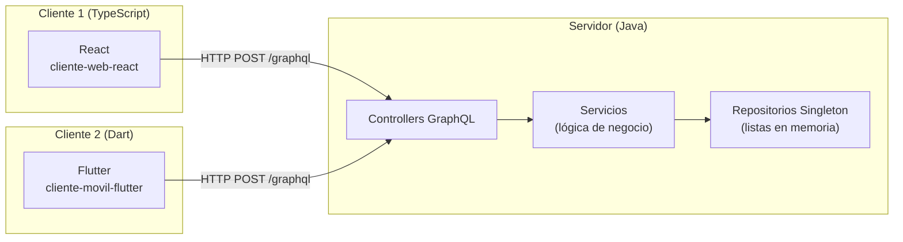
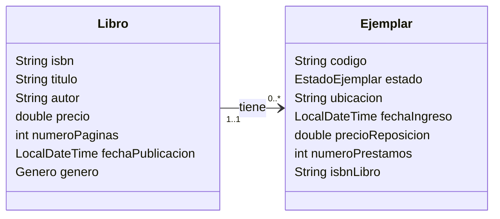

# Segundo Proyecto — Diseño de Soluciones (Universidad de Ibagué, 2026B)

[](https://github.com/Milan32555/SegundoProyecto-Libreria/actions/workflows/ci.yml)

Sistema de gestión de **Librería**, basado en el primer proyecto del curso (LibroFisico).
Arquitectura web distribuida: un servidor central expone la lógica de negocio mediante
**servicios web GraphQL** y dos clientes, escritos en lenguajes distintos entre sí y distintos
al del servidor, la consumen por la red.

**Integrantes:** Misael Gallo Tangarife · Sara Zambrano · Santiago Guimel · Alejandra González
**Versión:** 1.0.0

| Componente | Tecnología | Carpeta | Documentación |
|---|---|---|---|
| Servidor | Java 17 · Spring Boot 4 · Spring for GraphQL (puerto 8081) | [`servidor/ServidorLibreria`](servidor/ServidorLibreria) | [README](servidor/ServidorLibreria/README.md) |
| Cliente 1 | TypeScript · React 18 · Vite (navegador) | [`cliente-web-react`](cliente-web-react) | [README](cliente-web-react/README.md) |
| Cliente 2 | Dart · Flutter (Android, web, Windows) | [`cliente-movil-flutter`](cliente-movil-flutter) | [README](cliente-movil-flutter/README.md) |

## Arquitectura



Los dos clientes no comparten código: cada uno tiene su propio cliente GraphQL, modelos,
pantallas y Observer. Toda la información vive en memoria, en colecciones `List` del servidor.

## Caso de estudio: Libro (maestro) → Ejemplar (detalle)



Un `Libro` es un título editorial; un `Ejemplar` es una copia física de ese libro en el
inventario. Cada ejemplar pertenece a **un único** libro y un libro puede tener **0..\***
ejemplares. **Cada clase, por sí sola**, tiene los tipos exigidos:

| Tipo | Libro | Ejemplar |
|---|---|---|
| `int` | `numeroPaginas` | `numeroPrestamos` |
| `double` | `precio` | `precioReposicion` |
| `String` | `isbn`, `titulo`, `autor` | `codigo`, `ubicacion`, `isbnLibro` |
| `LocalDateTime` | `fechaPublicacion` | `fechaIngreso` |
| De elección (enum) | `genero` (`Genero`) | `estado` (`EstadoEjemplar`) |

Reglas de negocio que valida el servidor: ISBN y código únicos (sin distinguir mayúsculas),
campos obligatorios, precio y páginas mayores que cero, número de préstamos no negativo,
fechas no futuras, un ejemplar solo puede crearse para un libro existente, **no se puede
eliminar un libro que todavía tiene ejemplares** (quedarían huérfanos y se rompería la
relación 1..1) y **cada vez que un ejemplar pasa de otro estado a `PRESTADO`, el servidor
suma 1 a su `numeroPrestamos`**. Por eso, en *Actualizar Ejemplar* el número de préstamos se
muestra pero no se edita; en *Adicionar* se registra el valor inicial.

**Toda la lógica de negocio está en el servidor.** Los clientes solo capturan datos y muestran
lo que responde el servidor: los filtros de Listar, las búsquedas, el total de cada Listar
(`totalLibrosFiltrados`, `totalEjemplaresFiltrados`) y el resumen de la ventana principal
(`resumenInventario`: total de libros, total de ejemplares y ejemplares por estado con su
porcentaje) se calculan en el servidor. Las validaciones de los formularios en los clientes son
solo un aviso rápido; el servidor vuelve a validar todo.

## Cumplimiento del enunciado y la rúbrica

| Requisito | Cómo se cumple |
|---|---|
| Servicios web **GraphQL** | Esquema en [`schema.graphqls`](servidor/ServidorLibreria/src/main/resources/graphql/schema.graphqls), controllers con `@QueryMapping` / `@MutationMapping` |
| Dos clientes en lenguajes distintos al servidor y entre sí | Java (servidor), TypeScript/React y Dart/Flutter |
| Información almacenada en una **Lista** | `RepositorioLibros` y `RepositorioEjemplares` guardan `ArrayList` en memoria |
| Al menos 5 atributos (int, double, String, LocalDateTime y otro) | Ver diagrama de clases; escalar GraphQL propio `LocalDateTime` |
| **Insertar** | Pantallas *Adicionar Libro / Ejemplar* |
| **Eliminar** con búsqueda previa y mostrando TODA la información | Pantallas *Eliminar*: buscar → ficha completa → *Confirmar eliminación* |
| **Actualizar** con búsqueda previa y mostrando TODA la información | Pantallas *Actualizar*: buscar → formulario con todos los datos actuales → guardar |
| **Listar** en grilla con filtro (del lado del servidor) | Tabla/`DataTable`; Libros por autor y/o género, Ejemplares por estado y/o ISBN (`librosFiltrados`, `ejemplaresFiltrados`); el total encontrado también lo calcula el servidor |
| **Consultar UN objeto** por parámetros | Libro por ISBN **o** por título; Ejemplar por código |
| Una ventana por caso de uso | Cada opción del menú abre una pantalla/ruta dedicada a un solo caso de uso |
| Menú principal + **Ayuda → Acerca de...** con integrantes y versión | `BarraMenu` (React) y `MenuLateral` (Flutter) |
| Patrones MVC, Singleton, Builder, Observer y SOLID | Ver tabla siguiente |
| Subido a GitHub y compartido con el docente | Este repositorio |

## Patrones de diseño

| Patrón | Servidor (Java) | Cliente React | Cliente Flutter |
|---|---|---|---|
| **MVC** | `model` · `servicio` (lógica) · `controller` (GraphQL) | `types.ts` (modelo) · `graphql/` (acceso a datos) · `paginas/` y `componentes/` (vistas) | `modelos/` · `servicios/` · `pantallas/` |
| **Singleton** | `RepositorioLibros`, `RepositorioEjemplares` (`getInstancia()`, constructor privado) | `ClienteGraphQL.getInstancia()` | `ClienteGraphQL()` (constructor `factory`) |
| **Builder** | `LibroBuilder`, `EjemplarBuilder` | — | — |
| **Observer** | `ListadoObservable` + observador `RevisionListado` (cuenta los cambios de cada colección) | `ListadoObservable` + hook `useListadoObservado` en las pantallas de Listar | `ListadoObservable`; las pantallas de Listar se suscriben en `initState` |
| **SOLID** | Una responsabilidad por clase, inyección de dependencias por constructor, DTOs de entrada (`LibroInput`, …) separados de los modelos | Servicios por entidad, componentes de presentación reutilizables (`FichaLibro`, …) | Servicios por entidad, widgets reutilizables (`FichaLibro`, `CampoFecha`, …) |

### Cómo funciona el Observer en el caso de uso Listar

**Dentro de cada cliente (obligatorio):**

1. La pantalla *Listar* se **suscribe** al sujeto (`libroObservable` / `ejemplarObservable`)
   al abrirse y se **desuscribe** al cerrarse.
2. Las pantallas *Adicionar / Actualizar / Eliminar* llaman a `notificar()` tras una
   operación exitosa, y la grilla se vuelve a pedir al servidor de inmediato.

**Entre clientes (opcional):**

3. Mientras haya observadores, el sujeto consulta cada **15 s** `revisionLibros` /
   `revisionEjemplares` (un número que el servidor incrementa con cada cambio gracias a su
   propio Observer). Si cambió, notifica a sus observadores.

Así, si la pantalla *Listar* está abierta en el navegador y alguien agrega un libro **desde
la app Flutter** (u otra pestaña), la grilla se actualiza sola en máximo 15 s, respetando
los filtros que tenga escritos el usuario.

## Ejecución

Requisitos: **JDK 17+**, **Node.js 22.12+** y **Flutter 3.41+** (Dart 3.8+). Maven no hace
falta: el servidor incluye el Maven Wrapper (`mvnw`).

**Atajo en Windows para la demostración:** doble clic en [`iniciar-demo.cmd`](iniciar-demo.cmd).
Levanta el servidor y el cliente web, abre el navegador y, si hay un celular Android conectado por
USB (con depuración USB activada), conecta el puerto con `adb reverse`, instala la app y la abre.
La app que instala es `build/app/outputs/flutter-apk/app-release.apk`; se compila una vez con
`flutter build apk --release --dart-define=URL_GRAPHQL=http://localhost:8081/graphql`.

### 1. Servidor
```bash
cd servidor/ServidorLibreria
./mvnw spring-boot:run          # Windows: mvnw.cmd spring-boot:run
```
GraphQL en `http://localhost:8081/graphql` · consola GraphiQL en `http://localhost:8081/graphiql`.
Arranca con datos de prueba: 12 libros de literatura colombiana y latinoamericana con ISBN de
ediciones reales (por ejemplo `978-0307474728`, *Cien años de soledad*) y 20 ejemplares
(`EJ-001` a `EJ-020`) en los cuatro estados. *Delirio* (`978-8420401751`) no tiene ejemplares.

La ventana del servidor muestra una línea por cada operación, con la hora y el cliente que la
hizo (cada cliente envía el encabezado `X-Cliente: web` o `X-Cliente: movil`):

```
13:00:56  Cliente web  | consulta librosFiltrados + totalLibrosFiltrados (autor=garcia)
13:01:01  App móvil    | mutación crearLibro (isbn=978-1, titulo=Pedro Páramo)
13:01:04  Cliente web  | mutación eliminarLibro (isbn=978-0307474728)  -> RECHAZADA: No se puede eliminar…
```

Las consultas de revisión del Observer (cada 15 s) no se muestran para no llenar la consola;
se activan con `libreria.registro.incluir-revisiones=true` en `application.properties`.

### 2. Cliente web (React)
```bash
cd cliente-web-react
npm install
npm run dev
```
Abrir `http://localhost:5173`. Si el servidor está en otra máquina, crear un archivo `.env`
con `VITE_URL_GRAPHQL=http://<ip-del-servidor>:8081/graphql`.

### 3. Cliente móvil (Flutter)
```bash
cd cliente-movil-flutter
flutter pub get
flutter run                      # emulador Android, Chrome (-d chrome) o Windows (-d windows)
```
URL del servidor por defecto: `http://10.0.2.2:8081/graphql` en el emulador Android y
`http://localhost:8081/graphql` en web/Windows. En un **teléfono físico** (misma red Wi-Fi que
el computador):
```bash
flutter run --dart-define=URL_GRAPHQL=http://<IP-del-computador>:8081/graphql
```

## Pruebas

| Proyecto | Comando | Qué cubre |
|---|---|---|
| Servidor | `./mvnw verify` | 50 pruebas: servicios (CRUD, validaciones, filtros, totales, resumen del inventario, regla de préstamos, integridad, Observer), patrones, API GraphQL completa, registro de operaciones y servidor HTTP real con CORS |
| Cliente web | `npm test` · `npm run lint` | 41 pruebas: cliente GraphQL, Observer (incluida la detección de cambios de otro cliente cada 15 s), formatos y flujos de las pantallas |
| Cliente móvil | `flutter test` · `flutter analyze` | 33 pruebas: modelos, cliente GraphQL, Observer, validaciones y flujos de las pantallas con un servidor simulado |
| Cliente móvil ↔ servidor real | `flutter test test/integracion_servidor_test.dart --dart-define=URL_GRAPHQL=http://localhost:8081/graphql` | CRUD completo de Libro y Ejemplar contra el servidor en ejecución |

GitHub Actions ejecuta las pruebas, el lint y el build de los tres proyectos en cada push
([`.github/workflows/ci.yml`](.github/workflows/ci.yml)).

## API GraphQL

| Operación | Descripción |
|---|---|
| `libros` · `ejemplares` | Listar todos |
| `librosFiltrados(autor, genero)` | Listar libros filtrando por autor (contiene, sin tildes) y/o género |
| `totalLibrosFiltrados(autor, genero)` | Cuántos libros cumplen ese mismo filtro |
| `ejemplaresFiltrados(estado, isbnLibro)` | Listar ejemplares filtrando por estado y/o libro |
| `totalEjemplaresFiltrados(estado, isbnLibro)` | Cuántos ejemplares cumplen ese mismo filtro |
| `resumenInventario` | Total de libros, total de ejemplares y ejemplares por estado (cantidad y porcentaje) para la ventana principal |
| `libroPorIsbn(isbn)` · `libroPorTitulo(titulo)` · `ejemplarPorCodigo(codigo)` | Consultar UN solo objeto |
| `revisionLibros` · `revisionEjemplares` | Número de revisión de cada colección (Observer de los clientes) |
| `crearLibro` · `actualizarLibro` · `eliminarLibro` | CRUD de Libro |
| `crearEjemplar` · `actualizarEjemplar` · `eliminarEjemplar` | CRUD de Ejemplar |

Además, `Libro.ejemplares` devuelve los ejemplares de un libro y `Ejemplar.libro` su libro.
Ejemplo para probar en GraphiQL:

```graphql
query {
  libroPorIsbn(isbn: "978-0307474728") {
    titulo autor fechaPublicacion
    ejemplares { codigo estado ubicacion }
  }
}
```
